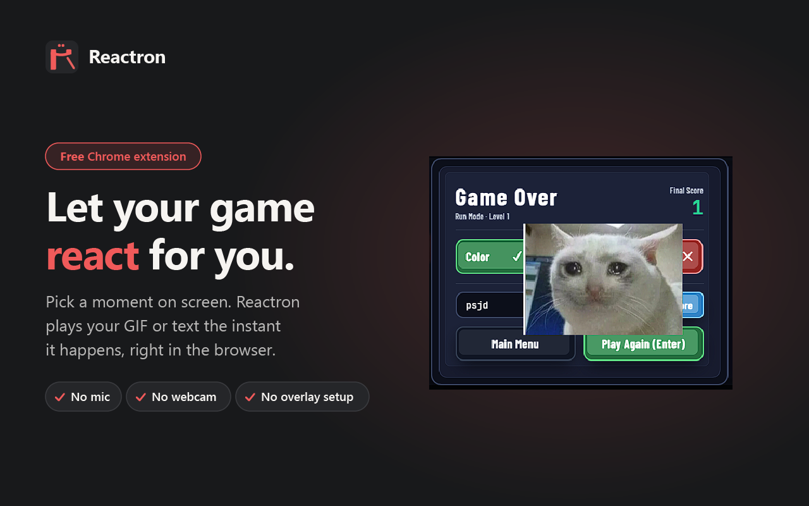

# Reactron — Custom Game Reactions (v1.0.0)



**Reactron** is an open-source, 100% local Manifest V3 Chrome Extension that adds configurable GIF/image and animated text reaction overlays to browser-based games. Using Chrome's native Side Panel and an in-memory visual-fingerprint engine, players can select up to two HUD Watch Regions per game (such as victory banners, round-end cards, or score indicators) and automatically trigger non-blocking visual reactions whenever the watched region matches the captured state.

---

## Table of Contents

1. [Version 1.0 Scope & Core Capabilities](#1-version-10-scope--core-capabilities)
2. [Repository Structure & Architecture](#2-repository-structure--architecture)
3. [Local-First Storage & Data Privacy](#3-local-first-storage--data-privacy)
4. [Known Limitations & Best Practices (v1.0)](#4-known-limitations--best-practices-v10)
5. [Quick Start, Forking & Development Workflow](#5-quick-start-forking--development-workflow)
6. [Chrome Web Store Packaging](#6-chrome-web-store-packaging)
7. [License & Contact](#7-license--contact)

---

## 1. Version 1.0 Scope & Core Capabilities

* **Persistent Chrome Side Panel UI (`chrome.sidePanel`)**: Remains docked beside the game viewport so players can configure Watch Regions, adjust detection strictness, and preview overlays without closing or obscuring the game tab.
* **Game Management & URL Identity Matching**: Registers active browser game tabs, normalizes URLs to prevent duplicate entries, and tracks real-time monitoring states (`ACTIVE`, `IDLE`, `DISABLED`, `PAUSED_NAVIGATED`, `UNSUPPORTED_PAGE`).
* **Interactive Watch Region Selection**: Up to **2 Watch Regions per game**, captured directly over HTML5 `<canvas>`, WebGL, or DOM surfaces using normalized surface coordinates that adapt when the browser window is resized.
* **Dual-Layer Reaction Engine (GIF/Image + Styled Text)**:
  * **GIF / Image Reactions**: Upload custom GIF, PNG, JPEG, or WebP assets (up to 5 MB), customize width (`64px`–`600px`), start delay, and display duration.
  * **Text Reactions**: Custom text strings with selectable typography (`Impact`, `Inter`, `Comic`, `Monospace`, `Serif`), custom hex/RGB color picker, font size, and entrance animations (`pop-in`, `slide-top`, `shake-burst`, `fade-zoom`, `flash-pulse`).
* **Zero-Interception Shadow DOM Overlay**: All runtime reactions render inside an isolated Shadow DOM container with `pointer-events: none !important`, guaranteeing that mouse clicks and keyboard controls pass straight through to the game uninterrupted.
* **Live Drag-and-Drop Reposition Mode**: Interactive corner handles let players drag GIF and Text overlays directly onto their preferred screen coordinates.
* **Reusable Reaction Library**: Save favorite GIF and Text reactions as reusable presets across multiple games, backed by automatic content-hash media deduplication.
* **Automatic Visual Fingerprint Detection & Cooldown Debouncing**: Samples the active game viewport at `500ms` intervals, compares a `12×12` RGB cell fingerprint against the captured baseline using a configurable **Strictness Slider (`1%`–`100%`)**, and suppresses duplicate re-triggers via a stateful `TriggerDebouncer`.

---

## 2. Repository Structure & Architecture

This repository contains two decoupled parts:
1. **`/extension` (Standalone Chrome Extension)**: Written in vanilla ES Modules (JavaScript + CSS) with **zero runtime dependencies**. You can load the `/extension` folder directly into Chrome via **Load unpacked** without running a bundler.
2. **`/src` & `/scripts` (Release Portal & Packaging Tooling)**: Companion web portal and automated ZIP bundler (`scripts/pack-extension.js`).

```text
├── extension/                         # Standalone Manifest V3 Chrome Extension (Load Unpacked directly)
│   ├── manifest.json                  # Chrome Extension Manifest V3 (v1.0.0)
│   ├── icons/                         # Extension icons (16, 32, 48, 128) & transparent UI logo
│   ├── background/
│   │   └── service-worker.js          # Viewport tab capture & background detection lifecycle
│   ├── content/
│   │   ├── content-script.js          # Shadow DOM overlay engine, region selector & reposition mode
│   │   └── content-style.css          # Host container reset styles
│   ├── popup/
│   │   ├── popup.html                 # Side Panel entry point (100% local assets, zero external CDNs)
│   │   ├── popup.css                  # Side Panel dark-charcoal design system (#18191B / #F05A5A)
│   │   └── popup.js                   # Application controller & screen router
│   ├── services/
│   │   ├── constants.js               # Centralized limits, defaults & timing constants
│   │   ├── detection-adapter.js       # Pluggable 12x12 visual-fingerprint comparison adapter
│   │   ├── detection-service.js       # Tab lifecycle tracking & 500ms visual sampling loop
│   │   ├── game-identity-service.js   # URL normalization & restricted-tab eligibility checks
│   │   ├── game-management-service.js # Game CRUD & active tab discovery
│   │   ├── media-service.js           # File validation & DataURL encoding
│   │   ├── media-storage.js           # IndexedDB binary asset store with deduplication & GC
│   │   ├── overlay-engine.js          # Message bridge for preview, execution & reposition modes
│   │   ├── persistence-service.js     # Schema validation, atomic storage & versioned migrations
│   │   ├── region-management-service.js # Watch Region & Reaction Configuration state transitions
│   │   ├── strictness-mapper.js       # Maps 1-100% user strictness slider to similarity thresholds
│   │   ├── trigger-debouncer.js       # Cooldown & sustained-match state machine
│   │   ├── viewport-layout-service.js # Responsive surface bounds & aspect-ratio coordinate projection
│   │   └── visual-fingerprint-service.js # RGB grid similarity math
│   ├── shared/
│   │   ├── schema.js                  # Storage keys, schema version & boundary validators
│   │   ├── types.js                   # Shared JSDoc typedefs & domain constants
│   │   └── validation.js              # Input & media validation helpers
│   └── ui/
│       ├── components.js              # Reusable UI primitives
│       ├── screen-dashboard.js        # Screen A: Saved games list & live monitoring status
│       ├── screen-game-setup.js       # Screen B: Watch Regions, strictness & reaction management
│       ├── screen-reaction-editor.js  # Screen C: GIF/Text configuration, preview & repositioning
│       └── screen-library.js          # Screen D: Saved GIF & Text preset library
├── scripts/
│   └── pack-extension.js              # Packages /extension into public/reactron-extension.zip
├── tests/
│   └── reactron.test.js               # Automated unit & integration test suite (Node test runner)
├── CONTRIBUTING.md                    # Architecture & pull-request guide for open-source contributors
├── PRIVACY_POLICY.md                  # Official Zero-Data-Collection Privacy Policy
├── CHROME_STORE_SUBMISSION.md         # Chrome Web Store listing & permission justification reference
└── LICENSE                            # MIT License
```

---

## 3. Local-First Storage & Data Privacy

Reactron operates **100% locally on the user's device**:
1. **Structured Configuration (`chrome.storage.local`)**: Game records, normalized Watch Region coordinates, strictness settings, and text reaction configurations are validated by `SchemaValidator` and persisted locally.
2. **Binary Media Offloading (`IndexedDB`)**: Uploaded GIFs and images are stored in `IndexedDB` (`reactron_media_db`) rather than `chrome.storage.local` to prevent storage quota exhaustion. Identical uploads are automatically deduplicated via content hashing, and orphaned media blobs are garbage-collected whenever games or presets are deleted.
3. **Zero External Telemetry or Servers**: No browsing history, screenshots, or user assets ever leave the browser. See [`PRIVACY_POLICY.md`](./PRIVACY_POLICY.md) for full details.

---

## 4. Known Limitations & Best Practices (v1.0)

Because Reactron v1.0 detects game events purely visually (without injecting into proprietary game memory or reading anti-cheat protected variables), users should be aware of the following operational characteristics:

1. **Highly Animated or Busy Backgrounds**:
   * *Limitation*: If a Watch Region covers a semi-transparent HUD element with moving 3D scenery, explosions, weather effects, or camera shake behind it, the underlying pixels change continuously and may reduce similarity accuracy.
   * *Best Practice*: Select opaque, high-contrast HUD badges, banners, or fixed-background dialog boxes, and set **Strictness** between `75%` and `90%`.
2. **Micro or Gradual HUD Changes**:
   * *Limitation*: Reactron computes a `12×12` spatial color fingerprint of the selected rectangle. A tiny change—such as a 2-pixel tick on a long health bar or a single digit changing inside a large region—may not shift the overall region fingerprint enough to distinguish states.
   * *Best Practice*: Draw the Watch Region box **tightly** around the specific icon, word, or segment that changes (minimum `10×10 px`), rather than selecting the entire top of the screen.
3. **Foreground Tab & Visible Window Requirement**:
   * *Limitation*: Chrome's `chrome.tabs.captureVisibleTab` API only captures the currently active tab in a visible browser window. If you switch to a different browser tab or minimize the window, visual sampling automatically pauses until you return to the game tab.
4. **Radical Responsive Layout Reflows**:
   * *Limitation*: `ViewportLayoutService` automatically projects Watch Region coordinates across window resizes and aspect-ratio letterboxing. However, if a game completely rearranges its DOM/HUD layout at mobile vs. desktop breakpoints, you may need to click **Reselect Area** for the new window layout.
5. **Restricted Pages & OS-Exclusive Fullscreen**:
   * *Limitation*: Chrome extensions cannot run on internal browser URLs (`chrome://`, `edge://`, `about:`, or the Chrome Web Store) or inside DRM-protected media surfaces.

---

## 5. Quick Start, Forking & Development Workflow

### Option A: Load Extension Directly in Chrome (No Build Step Required)
1. Fork and clone this repository:
   ```bash
   git clone https://github.com/<your-username>/reactron.git
   ```
2. Open Chrome and navigate to `chrome://extensions/`.
3. Enable **Developer mode** (top-right toggle).
4. Click **Load unpacked** and select the `extension` folder inside your cloned repository.
5. Click the **Reactron** icon in your Chrome toolbar to open the Side Panel.

### Option B: Run Tests, Package ZIP & Launch Release Portal
Requires **Node.js `v18+`** (or Bun):

```bash
# Install dev & packaging dependencies
npm install

# Run the automated unit & integration test suite (18 tests)
npm test

# Package /extension into public/reactron-extension.zip
npm run pack-ext

# Start the local release portal at http://localhost:3000
npm run dev
```

For architectural guidelines and instructions on submitting Pull Requests, see [`CONTRIBUTING.md`](./CONTRIBUTING.md).

---

## 6. Chrome Web Store Packaging

The `/extension` folder is self-contained and ready for direct upload to the [Chrome Web Store Developer Dashboard](https://chrome.google.com/webstore/devconsole):

* Run `npm run pack-ext` to generate a clean, deflated `public/reactron-extension.zip` containing only the production `/extension` files.
* Refer to [`CHROME_STORE_SUBMISSION.md`](./CHROME_STORE_SUBMISSION.md) for copy-paste permission justifications and store listing copy.

---

## 7. License & Contact

* **License**: [MIT License](./LICENSE)
* **Maintainer / Contact**: [promptsmithjd@gmail.com](mailto:promptsmithjd@gmail.com)
